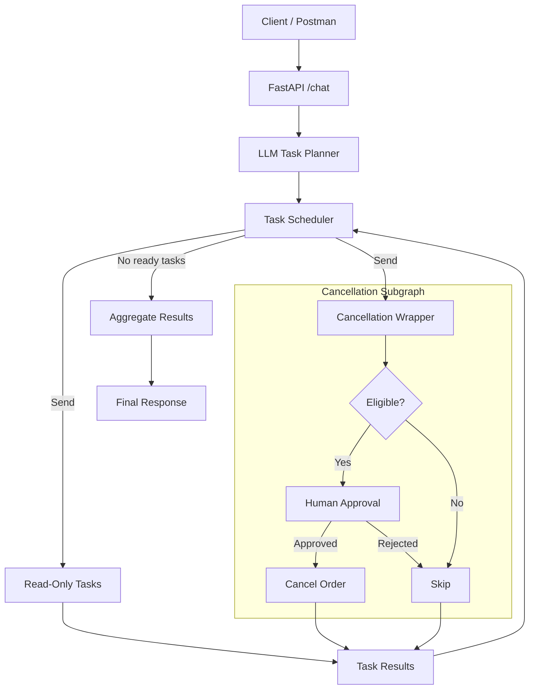

# AI Customer Support & Order Resolution System

A learning-focused, multi-intent customer support assistant built with **LangGraph**, **FastAPI**, and **OpenAI**. It turns customer messages into structured tasks, executes independent work concurrently, respects task dependencies, and requires human approval before cancelling orders.

The project is designed to demonstrate practical **AI workflow orchestration**

## Features

- **Structured task planning:** An LLM extracts tasks, order IDs, task dependencies, and selectors such as `MOST_RECENT` and `OLDEST` using Pydantic models.
- **Parallel execution:** LangGraph `Send` dispatches independent tasks concurrently. A reducer combines their outputs.
- **Dependency-aware scheduling:** Tasks wait for prerequisite tasks to complete; subsequent batches are dispatched as their dependencies become ready.
- **Parameter resolution:** A downstream task can resolve an order ID from a completed `GET_ORDERS` result using the order's `created_at` timestamp.
- **Cancellation subgraph:** Checks cancellation eligibility, pauses for approval, and executes cancellation only after approval.
- **Multiple human approvals:** Individual interrupts have IDs so separate cancellation requests can be approved or rejected independently.
- **Durable state:** PostgreSQL-backed checkpoints allow interrupted workflows to resume after an application restart.
- **Natural-language summaries:** The assistant turns completed task results into a customer-facing response.

## Architecture



The **AI orchestrator** communicates with the **mock commerce backend** over HTTP. It does not access the mock backend's data store directly. LangGraph checkpoints are stored separately in PostgreSQL.

## Tech stack

| Component | Technology |
| --- | --- |
| API | FastAPI, Pydantic |
| Orchestration | LangGraph (`StateGraph`, `Send`, reducers, subgraphs, interrupts) |
| LLM integration | OpenAI Python SDK (`AsyncOpenAI`) |
| Backend communication | HTTPX (`AsyncClient`) |
| Checkpoint persistence | PostgreSQL, `AsyncPostgresSaver` |
| Local database | Docker |

## Project organization

```text
ai-support/
├── main.py                     # FastAPI lifespan and endpoints
├── graph/
│   ├── state.py                # Parent and task-specific state schemas
│   ├── nodes.py                # Task planning, execution, and aggregation
│   ├── workflow.py             # Parent graph and task scheduler
│   └── cancellation_workflow.py # Cancellation subgraph
├── schemas/
│   └── intent.py               # Structured task-plan models
├── services/
│   └── commerce_client.py      # HTTP client for the mock backend
├── .env                        # Local secrets and service URLs (do not commit)
└── README.md
```
The mock backend is a **separate FastAPI service**. Its storage and implementation can remain minimal for this project.
